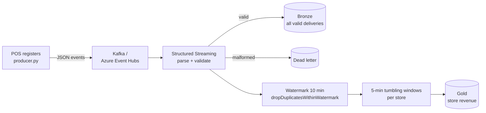

# Real-Time Retail Streaming


  

Near-real-time point-of-sale analytics with **Spark Structured Streaming**. Store POS events arrive through **Kafka or Azure Event Hubs**, malformed events go to a **dead-letter table**, redelivered events are **deduplicated within a watermark**, late events are handled correctly, and revenue is aggregated per store in **5-minute windows** into Delta Lake.

## Architecture



## Streaming problems this handles

| Problem | Solution |
|---|---|
| **At-least-once delivery** (the same event arrives twice) | `dropDuplicatesWithinWatermark(["event_id"])` keeps dedup state bounded by the watermark. |
| **Late events** | A 10-minute watermark finalizes windows; events older than that are dropped from aggregates instead of reopening closed windows (they are still kept in Bronze for audit). |
| **Bad data** | Unparseable JSON and rule violations (missing IDs, zero quantity, unknown type) are routed to a dead-letter table rather than failing the stream. |
| **Returns** | Returns are signed negative, so windows report true net revenue and units. |
| **Exactly-once output** | Each sink has its own checkpoint; append-mode window output is written once per finalized window. |
| **Event Hubs** | `kafka_options()` switches to SASL_SSL with the connection string from a Key Vault secret, using Event Hubs' Kafka-compatible endpoint. |

## Sample run (simulated, 8 micro-batches)

The producer generated 4,000 events plus 80 redeliveries, 3 very late events, and 16 malformed messages:

| Output | Rows | Notes |
|---|---|---|
| Bronze | 4,083 | every valid delivery, kept for replay and audit |
| Dead letter | 16 | all malformed messages caught |
| Gold windows | 60 (5 windows × 12 stores) | each event counted exactly once; late events excluded |

The final windows stay open until the watermark passes them, which is the expected streaming behavior.

| window_start | store | net_revenue | net_units | events | returns |
|---|---|---|---|---|---|
| 09:00 | S001 | 5,204.85 | 90 | 40 | 2 |
| 09:00 | S002 | 6,992.37 | 113 | 49 | 1 |
| 09:00 | S003 | 6,078.44 | 99 | 40 | 3 |

The end-to-end test recomputes the expected count for every window independently in plain Python and asserts that Spark's output matches exactly.

## Run it locally

Requires Python 3.10+ and Java 17.

```bash
pip install -r requirements.txt

# file-based source (no broker needed)
PYTHONPATH=src python -m retail_streaming.producer --out data/landing/pos
PYTHONPATH=src USE_DELTA=1 python -m retail_streaming.stream_job --source files \
  --input data/landing/pos --lake data/lake --available-now

pytest -q
```

### With Kafka

```bash
docker compose -f docker/docker-compose.yml up -d
pip install -r requirements-kafka.txt
PYTHONPATH=src python -m retail_streaming.producer --kafka localhost:9092 --topic pos-events &
PYTHONPATH=src python -m retail_streaming.stream_job --source kafka --bootstrap localhost:9092 --topic pos-events
```

Add `spark.jars.packages=org.apache.spark:spark-sql-kafka-0-10_2.12:3.5.3` when running the Kafka source outside Databricks.

### With Azure Event Hubs on Databricks

Set `EVENTHUBS_CONNECTION_STRING` from a Key Vault-backed secret scope and use `--bootstrap <namespace>.servicebus.windows.net:9093`.

## Project structure

```
src/retail_streaming/
  events.py       schema, parsing, validation, dead-letter split, windowed aggregation
  producer.py     simulated POS events (duplicates, late, malformed) to files or Kafka
  stream_job.py   streaming sinks with checkpoints; files / Kafka / Event Hubs sources
docker/           single-node Kafka (KRaft)
tests/            parsing tests + end-to-end streaming test with exact window verification
```

## Tech stack

Spark Structured Streaming · PySpark · Kafka · Azure Event Hubs · Delta Lake · Azure Databricks · Docker · pytest · GitHub Actions
